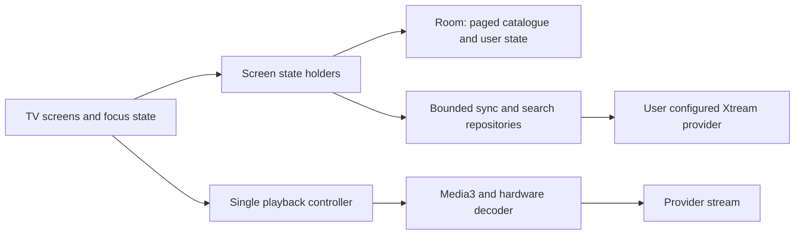

# Fire TV application plan

Draft for review · 19 October 2026 · Implementation of the first release was authorised later the same day; see [STATUS.md](STATUS.md) for what was built and tested.

Owner interview update: [PRODUCT.md](../PRODUCT.md) is now confirmed and takes precedence over this original sequencing. General trending discovery and new/trending Korean and Chinese films and shows are core release requirements. One shared household uses a 55-inch Philips Ambilight 4K; the priorities are avoiding crashes, useful discovery and smooth playback/navigation. Release signing is configured privately. Version 0.2.0 adds direct, optional TMDB token configuration, English subtitles for foreign audio, and playback-prioritised library refresh.

## Outcome and confirmed device

Build a personal TV player that is quick to browse and dependable during long viewing sessions. The immediate replacement use case is an existing player reported to crash and slow down the stick. Its cause has not been diagnosed; this plan controls the new app's resource use and verifies behaviour on hardware rather than assuming a particular cause.

The user confirmed a Fire TV Stick 4K, 2nd generation, with Fire OS **8.1.8.2 (RS8182/3811)** and Home **7313002.1**. Amazon identifies this generation as **AFTKM**, Android 11/API 30, **2 GB RAM**, a **32-bit application ABI**, and 8 GB storage. This is the primary acceptance device. An Android APK is appropriate for this Fire OS device. See [Amazon's specifications](https://developer.amazon.com/docs/device-specs/device-specifications-fire-tv-streaming-media-player.html?v=ftvstick4k_gen2_8).

Success means starting familiar content with few remote presses, recovering cleanly from bad streams or connectivity loss, and leaving the Fire TV responsive after playback ends. A crash-free guarantee is not measurable; the release gates in [ACCEPTANCE.md](ACCEPTANCE.md) define the evidence required.

## First useful release

| Area | Proposed behaviour |
| --- | --- |
| Setup | Enter Xtream server, username and password using the Fire TV keyboard; optional remember choice, readable inline errors and a connection check. No hardcoded account. |
| Home | Continue Watching, Favourite Channels and Recently Added. A small branded welcome region; no autoplay previews. |
| Live TV | Categories, favourites, searchable channel list, selected-channel now/next EPG where supplied, and explicit full-screen playback. Browsing does not start another stream. |
| Movies | Paged poster grid, search, practical filters, details, language/quality edition selection, Play/Resume and My List. |
| Series | Same catalogue rules, provider seasons and episodes, resume the correct episode and an explicit next-episode action. |
| Search | One search across locally indexed Live TV, Movies and Series; cancellable, debounced input, visible scope and complete paged results. Index coverage is shown during first sync. |
| My List | Local favourites and saved titles, scoped to the provider account. |
| Player | Remote play/pause, seek where supported, audio/subtitle selection, live indicator, actionable playback errors and return to the exact browsing position. |
| Settings | Account, preferred language, quality preference, subtitle preferences, refresh library, cache controls, app version and local diagnostics. |

First release excludes recording, timeshift, downloads, multi-screen playback, background audio, auto-playing trailers, cloud sync, multi-profile management, mandatory companion servers and Appstore publication. These add resource or delivery complexity without proving the primary playback task.

The original plan deferred TMDB discovery. The owner interview superseded that decision: general weekly trends and dedicated new/trending Korean and Chinese rows now belong in this release. Provider metadata and artwork remain the playback baseline. Never label provider ratings as trending, invent programme data, or present a title as playable unless it exists in the provider catalogue.

## Proposed technical direction

| Decision | Reason and boundary |
| --- | --- |
| Kotlin + Compose for TV | Native TV focus and lifecycle handling with a small platform stack. Theme TV components with the existing brand. Verify lazy rows/grids and focus restoration on the real stick in the first technical slice. |
| Media3/ExoPlayer | One native player, hardware decoder capability checks and explicit resource ownership. Use a SurfaceView-backed video surface; keep UI independent from frame rendering. |
| Room + paging | Persist catalogues, variants, favourites and progress without retaining entire provider responses in memory. Search/index work runs off the main thread. |
| OkHttp + streaming JSON reader | Bounded connections and cancellation; process large provider arrays into database batches instead of constructing multiple full catalogues in memory. |
| DataStore + Android Keystore | Store non-sensitive settings separately; encrypt remembered credentials with a Keystore-held key. Keep credentials out of navigation state, logs and backups. |
| One image loader | Resize to the actual display slot, bounded RAM/disk caches, cancel off-screen work; no parallel image-loading stacks. Coil is the proposed choice. |
| One app module initially | Feature packages for setup, library, live, details, playback and settings; repositories own data and a single playback controller owns the player. Split Gradle modules only when complexity warrants it. |

Propose minSdk 30 for this personal Fire OS 8 release. Select and pin compatible stable dependency, compile SDK and target SDK versions during implementation. Fire OS 7 and other Android TV devices are later compatibility targets, not assumed supported. No Google Play Services dependency. If a dependency contains native code, the build must include **armeabi-v7a** for this stick; an arm64-only APK will not meet the primary target.

Android's current TV guidance supports [Compose for TV](https://developer.android.com/training/tv/playback/compose). This is a proposed architecture, not evidence of measured performance. If the initial browse/play slice misses the agreed resource or focus targets after bounded tuning, reassess the UI implementation before expanding features.

### Data and provider access

Connect directly to the user's Xtream provider. Native networking does not require the website's browser CORS proxy. Avoid a dependency on the protected website, reverse-proxy login or its session cookies. Existing web accounts, browser favourites and progress do not automatically migrate or sync.

Bootstrap account status, categories and one useful catalogue first. Refresh the remaining catalogue types sequentially in the foreground. Some Xtream providers return an entire catalogue rather than true pages: parse those responses as a stream into bounded transactions, then page locally. Deduplicate simultaneous refreshes, cancel on logout, and keep the last complete database generation until its replacement succeeds. An interrupted refresh must not erase the working library.

Retain the existing domain rules as requirements: group movie/series editions only by media type plus valid TMDB ID; keep every provider ID, language, quality and container extension; leave missing IDs separate; keep live channel identities separate. Namespace data by a non-secret account identifier. Port rules with synthetic fixtures rather than copying the existing repository or its credential defaults.

Global search uses normalized Unicode text, ranked exact/prefix/token matches, indexed candidates and local paging. Verify punctuation, accents, Arabic, mixed direction text and numbers. Show searchable types and last refresh state; a partial first sync must not silently claim complete results. Fetch title details, seasons and now/next EPG on demand. Full XMLTV ingestion is deferred.

### Playback and failure control

- Exactly one active player and one open stream. A new selection cancels the old preparation and releases its media before opening another; stale callbacks cannot replace the newest selection. Respect provider connection limits.
- Start with HLS, progressive MP4 and MPEG-TS where the provider supplies them. Test Matroska and other encountered containers as part of compatibility; container support does not establish codec/audio/HDR support. See [Media3 format support](https://developer.android.com/media/media3/exoplayer/supported-formats).
- Select supported hardware decoding; inspect the chosen decoder, codec profile, HDR display capability and audio route. Do not silently use an expensive software decoder for unsupported 4K. Offer an available compatible edition or an honest error. No bundled FFmpeg/VLC engine in the initial build.
- Adaptive quality changes require a manifest containing alternatives. A fixed 4K stream cannot become 1080p locally; a lower-quality provider edition is a separate selection. Preserve language and user intent, and never loop through every edition automatically.
- On transient network failures, allow at most three automatic retries with backoff, within a 30-second recovery window; cancel immediately when leaving playback. Authentication and unavailable-content errors require action rather than repeated retries. Initial preparation and no-progress stalls also have finite watchdogs.
- Save VOD/episode progress periodically and on pause/exit; save IDs and positions, not playable URLs. Recreate a fresh player on return. Handle expired credentials and removed content without losing unrelated favourites.
- Stop playback and release decoder, video surface, timers and network activity when the playback activity stops or the user exits. Do not rely on onDestroy. Re-enter from saved state after sleep, Home or process death. Follow [Media3 lifecycle guidance](https://developer.android.com/media/implement/playback-app).

Use HTTPS by default. If a provider only supports HTTP, design an explicit compatibility choice explaining that credentials and streams travel without transport encryption; do not disable certificate verification. Scope any cleartext support to that selected provider and test its implementation on Fire OS. Strip credential-bearing query/path data from logs, screenshots, crash output and diagnostic exports. Provider artwork URLs can also contain tokens and need the same treatment.

## Delivery sequence after planning approval

| Phase | Deliverable | Exit condition |
| --- | --- | --- |
| 0 — Design review | Review this brief, reference captures and representative provider/format requirements. Confirm naming and code licence. | Resolve scope corrections; agree screen/focus behaviour. Live visual reference capture is still outstanding. |
| 1 — Prove the device | Minimal signed debug install, focusable list, one live stream, one VOD, lifecycle handling and resource instrumentation. | Playback/suspend/channel-change slice works on AFTKM with 32-bit compatibility; baseline measurements recorded. |
| 2 — Useful library | Setup, resilient database sync, Home, Live TV, Movies, Series, search, detail/episode views and local state. | Entire core journey works by D-pad; partial/offline/failed-sync states are correct. |
| 3 — Brand and hardening | Implement the approved ink/sage TV brief, accessibility, error recovery, image/buffer budgets and focus restoration. | Visual and interaction matrix passes at 1080p and on a 4K TV; performance targets met or explicitly revised using evidence. |
| 4 — Personal release | Repeatable signed release APK, SHA-256 checksum, install/update instructions and changelog. | Hardware soak and recovery gates pass; install/update retains user state. |
| 5 — Optional parity | Evaluate TMDB discovery, companion-assisted setup or explicit cross-device sync separately. | Each addition has an agreed need and resource cost. |

Future automation can run Gradle checks, synthetic provider contract tests and an unsigned/debug build on pull requests. A user-triggered release can publish a signed APK only after the hardware evidence is recorded. Keep the long-lived signing key backed up privately, separate debug and release identities, and preserve release package ID/signing certificate for upgrades. No build workflow or signing key is created during this task.

## Evidence and open decisions

The incumbent React/Express source was reviewed: its palette and typography, Brand component, navigation, grouped catalogue rules and documented discovery behaviour. The live website returned an authentication challenge, so no claim of live visual sign-off is made. Match authenticated captures before implementing the UI. The design brief records exact source colours and clearly labels proposed TV dimensions.

[Impeccable shape](https://github.com/pbakaus/impeccable/blob/main/.agents/skills/impeccable/reference/shape.md), [established-world guidance](https://github.com/pbakaus/impeccable/blob/main/.agents/skills/impeccable/reference/new-work.md), Android guidance and Operate principles informed this plan. The local Impeccable launcher was unavailable; context was read directly. This is a draft brief, not an approved design contract or rendered prototype.

Before implementation, settle only the remaining material choices: final app/package name and code licence, provider examples that establish stream/EPG compatibility, and any corrections to the proposed MVP. Working product name: **HostAppTV**. Proposed repository: **xtream-iptv-firetv**. Provider access and signing material remain private.
